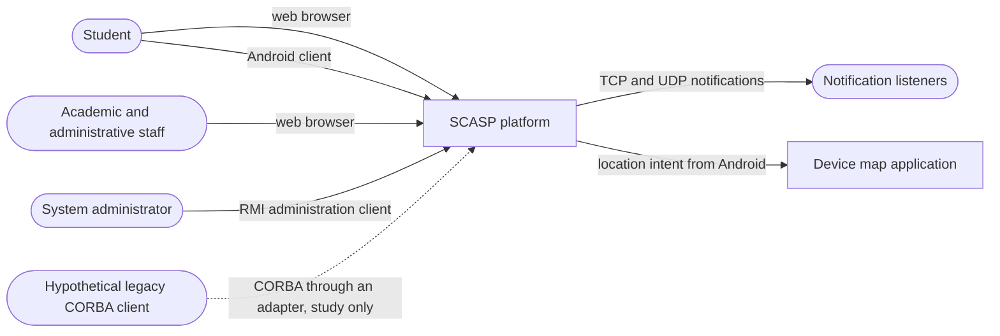
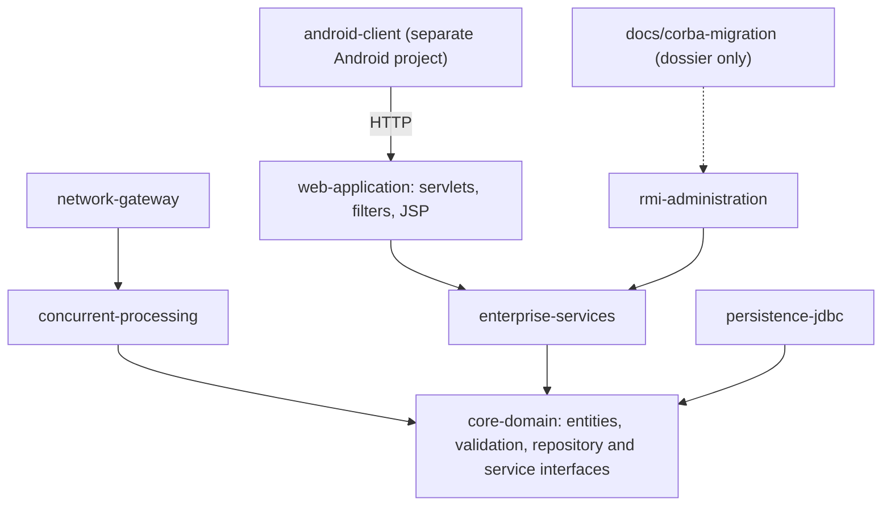
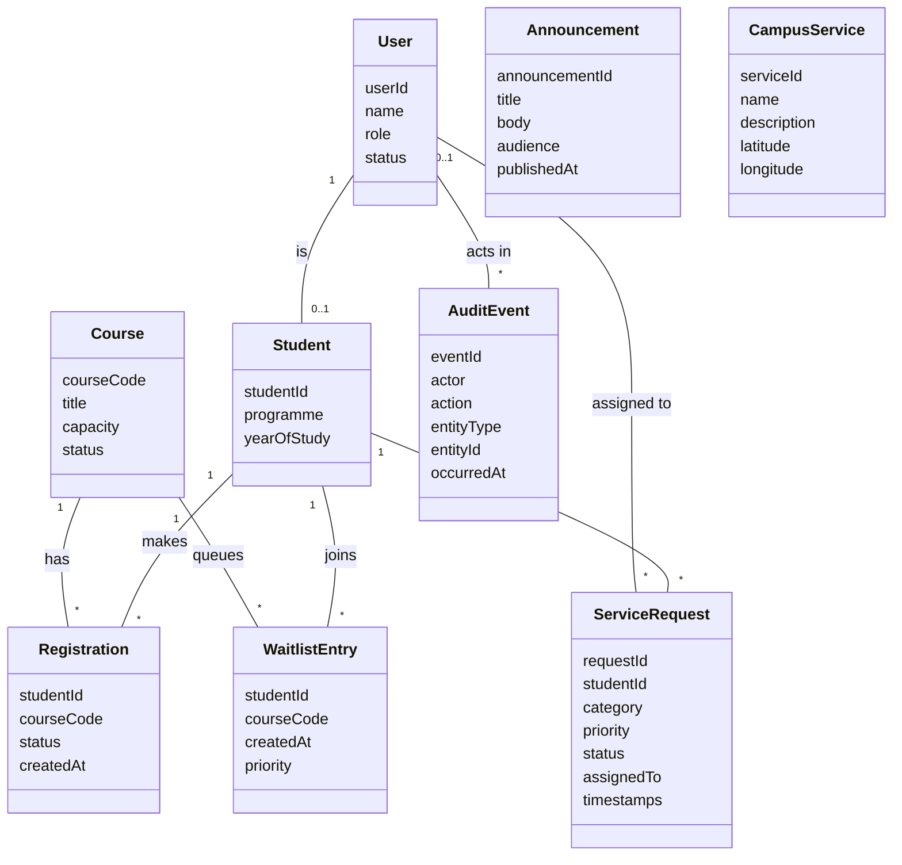
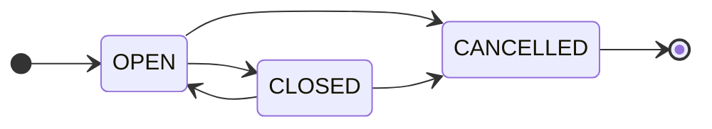
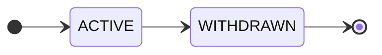
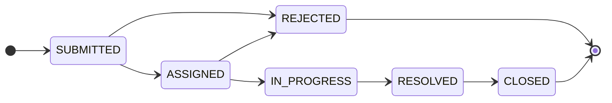

# Architecture Baseline

The diagrams below use Mermaid, which GitHub renders directly in this file.

## 1. Context diagram

## 2. Modules and dependency rule

| Module | Responsibility | Stage |
|---|---|---|
| core-domain | Entities, validation, repository and service interfaces, collection-based repositories | 1 |
| concurrent-processing | Tasks, bounded queue, executor, statistics, orderly shutdown | 2 |
| network-gateway | TCP and UDP protocol, client and server, notifications | 3 |
| enterprise-services | Stateless and singleton beans, lifecycle, container transactions | 4 |
| persistence-jdbc | Schema, JDBC repositories, transactions (database scripts live in `database/`) | 5 |
| web-application | Servlet controllers, filters, sessions, JSP views | 6, 7 |
| rmi-administration | Remote interface, registry, server, administration client | 8 |
| docs/corba-migration | IDL, comparison matrix, migration plan | 9 |
| android-client | Activities, intents, background work, cache, location and maps | 10 |

**Dependency rule.**

- `core-domain` depends on no other module, and every other module depends on its interfaces.
- Implementations (in-memory, JDBC) are chosen when the application is wired together, so Stage 5 can replace storage without changing callers.
- Business rules live in the domain services only. Controllers, beans and the RMI layer call them and never copy them.
- Network, web, RMI and Android clients exchange DTOs, never persistence internals.

## 3. Domain model

## 4. Status transitions

The first diagram is the course status, the second the registration status, and the third the service request status. Any other transition is rejected.

## 5. Domain invariants

Each invariant is covered by at least one test in Stage 1.

| ID | Invariant |
|---|---|
| I-01 | A student has at most one active registration for a course |
| I-02 | Active registrations for a course never exceed its capacity |
| I-03 | A student is never both registered and on the waiting list for the same course |
| I-04 | Waiting-list order is stable (first in, first out), and promotion takes the head of the queue |
| I-05 | A withdrawal frees exactly one seat, and a promotion happens only when a seat is free and a student is waiting |
| I-06 | Identifiers are unique and never change after creation |
| I-07 | Status changes follow the allowed transitions only |
| I-08 | Only authorised roles can perform each operation (for example, students cannot create courses or assign requests) |
| I-09 | Every important state change produces an audit event with actor, action and time |
| I-10 | Collections returned from services cannot be used to change internal state |
| I-11 | Course capacity is a positive whole number |

## 6. Key design decisions

| ID | Decision | Reason |
|---|---|---|
| D-01 | Maven multi-module build, with modules added stage by stage | Matches the stage plan and keeps each stage buildable |
| D-02 | Repository and service interfaces live in `core-domain` | Lets Stage 5 replace in-memory storage with JDBC without changing callers |
| D-03 | DTOs at network, RMI and web boundaries | Keeps persistence internals hidden and gives stable remote contracts |
| D-04 | Registrations in a Set, waiting lists in a Queue, prioritised requests in a PriorityQueue | Each collection expresses its rule directly (Stage 1) |
| D-05 | The Android client is a separate Android Studio project that calls the Stage 6 HTTP endpoint | Android builds with Gradle, and a controlled mock is the fallback if networking is unavailable |
| D-06 | CORBA is treated as a documentation study | The Java CORBA modules were removed from the JDK, so the brief makes an implementation optional |
